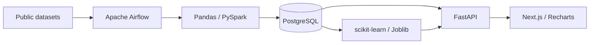

# EcoPulse AI

**Intelligent energy consumption monitoring, forecasting and anomaly detection.**

A local-first data and analytics platform built as a solo portfolio project. It
combines data engineering, machine learning, and full-stack development on a
fully inspectable local stack: no cloud hosting, no paid services, and no
invented production data.

> **Project status: Phase 2 - Dataset and EDA.**
> The monorepo, interface, API health contract, database wiring, containers, and
> CI are in place. Phase 2 adds the raw UCI dataset, inspection reports, and an
> executed EDA notebook. Domain ingestion, models, and analytics views are
> deliberately not implemented yet.

---

## What this is

EcoPulse AI is being built to answer three practical questions from real energy
data:

1. **What is consuming energy?** - interval-level monitoring with transparent
   data-quality treatment.
2. **What happens next?** - consumption forecasts evaluated with chronological
   splits and documented error metrics.
3. **What changed?** - anomaly detection that explains deviations in context.

The project is designed as a complete path from public dataset to local
analytics interface. Every layer is documented so the system can be understood,
run, and verified by another developer.

### What is intentionally absent

- No synthetic production data, sample dashboards, or placeholders that look
  like real measurements.
- No ML predictions, anomaly scores, or model artefacts in this phase.
- No cloud infrastructure, paid APIs, or live deployment.
- No authentication or multi-user tenancy; this is a local single-user project.
- No Airflow or Spark runtime in Phase 2. They are documented in the target
  architecture and will be added with the data pipeline.

---

## Stack

| Layer | Technology | Role |
| --- | --- | --- |
| Interface | Next.js 16, React 19, TypeScript, Tailwind CSS 4, Recharts | Product surface and future analytics views |
| API | Python, FastAPI, Pydantic, SQLAlchemy 2 | Typed local service and health contract |
| Database | PostgreSQL 17, Alembic | Durable storage and versioned schema |
| Data engineering | Pandas, NumPy, PySpark, Apache Airflow | Ingestion, validation, transformation and orchestration |
| Machine learning | scikit-learn, Joblib | Forecasting and anomaly detection (later phases) |
| Testing | Pytest, Ruff, ESLint, TypeScript | Backend tests and frontend quality gates |
| Infrastructure | Docker, Docker Compose, GitHub Actions | Reproducible local runtime and CI |

Python environments are intentionally separated:

- `backend/` runs the API only.
- `data-engineering/` and `machine-learning/` carry the heavier analytics stack.
- Airflow will run in its own container, not in the API virtual environment.

---

## Architecture

The target data path is documented in [docs/architecture.md](docs/architecture.md).



Implemented in Phase 1:

- Next.js interface with a live infrastructure-status panel
- FastAPI service with liveness, readiness, and aggregate health endpoints
- SQLAlchemy session layer and an Alembic baseline migration
- PostgreSQL and application images wired through Docker Compose
- CI for backend lint/tests, frontend lint/types/build, and Compose validation

Phase 2 adds:

- UCI Individual Household Electric Power Consumption dataset pinned in `data/raw/`
- Dataset inspection script and five generated reports in `reports/eda/`
- Executed EDA notebook with ten saved figures (`reports/eda/figures/`)

Still not implemented: automated dataset download, domain ingestion, schema
domain models, Airflow DAGs, Spark jobs, trained models, forecasts, anomaly
detection, and energy dashboards.

---

## Repository layout

```text
EcoPulse-AI/
├── .github/workflows/ci.yml    CI: backend, frontend, Compose validation
├── .env.example                Docker Compose environment
├── airflow/
│   └── dags/                   Reserved for Phase 2+ DAGs
├── backend/
│   ├── alembic/                Migration environment and baseline revision
│   ├── app/
│   │   ├── api/v1/             Versioned HTTP routes
│   │   ├── core/               Settings
│   │   ├── db/                 SQLAlchemy engine, session, declarative base
│   │   ├── models/             ORM models (empty until Phase 2)
│   │   ├── schemas/            Pydantic response models
│   │   └── main.py             FastAPI application factory
│   ├── tests/                  Pytest health-contract tests
│   ├── Dockerfile
│   └── requirements*.txt
├── data/
│   ├── raw/                    Immutable downloads (ignored by Git)
│   ├── processed/              Derived datasets (ignored by Git)
│   └── external/               Third-party reference data (ignored by Git)
├── data-engineering/
│   ├── src/                    Future ingestion and transformation modules
│   ├── notebooks/              Exploratory notebooks
│   └── requirements.txt
├── database/
│   ├── init/                   Future bootstrap SQL
│   └── seeds/                  Small documented reference data
├── docs/
│   ├── architecture.md
│   ├── design-system.md
│   └── development.md
├── frontend/
│   ├── app/                    App Router pages, layout, global styles
│   ├── components/             Product surface and live status components
│   ├── lib/                    Site configuration and health client
│   ├── Dockerfile
│   └── package.json
├── machine-learning/
│   ├── src/                    Future training and evaluation modules
│   ├── notebooks/
│   ├── models/                 Local Joblib artefacts (ignored by Git)
│   └── requirements.txt
├── scripts/                    Reserved for repeatable operations
├── tests/                      Future cross-system tests
└── docker-compose.yml
```

---

## Quick start

### Prerequisites

- Windows 11
- Node.js 22+ and npm
- Python 3.11-3.13 (3.13 tested locally; containers use 3.12)
- Docker Desktop with the WSL 2 backend
- Git

Java 17 is only needed for future PySpark work; Airflow will run in Docker
because it does not support native Windows execution.

### Option A - full stack with Docker Compose

```powershell
cd D:\ai\EcoPulse-AI
Copy-Item .env.example .env
# Start Docker Desktop first, then:
docker compose up --build
```

| Service | URL |
| --- | --- |
| Web interface | http://localhost:3000 |
| FastAPI docs | http://localhost:8000/docs |
| Aggregate health | http://localhost:8000/api/v1/health |
| PostgreSQL | localhost:5432 |

Stop the stack with `docker compose down`. Add `-v` only when you intentionally
want to delete the local database volume.

### Option B - local development

Start PostgreSQL only:

```powershell
cd D:\ai\EcoPulse-AI
docker compose up -d db
```

Backend (terminal 1):

```powershell
cd D:\ai\EcoPulse-AI\backend
py -3.13 -m venv .venv
.\.venv\Scripts\Activate.ps1
python -m pip install -r requirements-dev.txt
Copy-Item .env.example .env
alembic upgrade head
uvicorn app.main:app --reload --port 8000
```

Frontend (terminal 2):

```powershell
cd D:\ai\EcoPulse-AI\frontend
npm install
Copy-Item .env.example .env.local
npm run dev
```

Open http://localhost:3000. The status panel queries the real API health
endpoint; when PostgreSQL is unavailable it reports a degraded state instead of
inventing a successful one.

---

## Environment variables

| Variable | Used by | Default / example | Purpose |
| --- | --- | --- | --- |
| `POSTGRES_DB` | Compose | `ecopulse` | Database name |
| `POSTGRES_USER` | Compose | `ecopulse` | Database role |
| `POSTGRES_PASSWORD` | Compose | `ecopulse_local_dev` | Local-only password |
| `POSTGRES_PORT` | Compose | `5432` | Host port for PostgreSQL |
| `API_PORT` | Compose | `8000` | Host port for FastAPI |
| `FRONTEND_PORT` | Compose | `3000` | Host port for Next.js |
| `DATABASE_URL` | Backend | `postgresql+psycopg://...` | SQLAlchemy connection URL |
| `CORS_ORIGINS` | Backend | `http://localhost:3000,...` | Comma-separated browser origins |
| `ENVIRONMENT` | Backend | `development` | `development`, `test`, or `production` |
| `DEBUG` | Backend | `false` | Debug flag |
| `NEXT_PUBLIC_API_URL` | Frontend | `http://localhost:8000` | Browser-accessible API base URL |

Copy the provided `.env.example` files. Never commit `.env` files. Docker
Compose uses the root `.env`; native backend and frontend development use their
own local files.

---

## Quality checks

```powershell
# Backend
cd D:\ai\EcoPulse-AI\backend
.\.venv\Scripts\Activate.ps1
ruff check .
pytest

# Frontend
cd D:\ai\EcoPulse-AI\frontend
npm run lint
npm run typecheck
npm run build

# Compose configuration
cd D:\ai\EcoPulse-AI
docker compose --env-file .env.example config --quiet
```

GitHub Actions runs the same quality gates, including migrations against a real
PostgreSQL service. Container images are not yet built in CI; Compose syntax is
validated there and local builds are documented in
[docs/development.md](docs/development.md).

### API endpoints

| Method | Path | Behaviour |
| --- | --- | --- |
| `GET` | `/` | Service metadata |
| `GET` | `/docs` | Swagger UI |
| `GET` | `/api/v1/health` | Aggregate health; always `200`, may be `degraded` |
| `GET` | `/api/v1/health/live` | API liveness; no database access |
| `GET` | `/api/v1/health/ready` | Readiness; `503` when a dependency is unavailable |

---

## Data principles

The project uses real public datasets only. Phase 2 selects the UCI household
dataset, records its source, licence and SHA-256 checksum, and profiles it before
any data is ingested. Automated retrieval and the formal manifest are future
work.

- Raw data stays immutable in `data/raw/`.
- Processed data is reproducible, never hand-edited.
- No chart is populated with invented values.
- Model quality is reported against a baseline with chronological evaluation.

See [data/README.md](data/README.md) and
[docs/architecture.md](docs/architecture.md#data-principles).

---

## Design direction

The interface uses a premium energy-intelligence identity: deep green-black
surfaces, restrained signal green, Geist typography, fine hairlines, and a
compact instrument-panel hierarchy.

### Palette

| Token | Hex | Usage |
| --- | --- | --- |
| Canvas | `#101713` | Page background |
| Surface | `#171F19` | Panels and cards |
| Surface raised | `#202A22` | Hover / secondary surfaces |
| Primary green | `#8BCF9B` | Signal, focus, primary actions |
| Accent green | `#B6E3B7` | Hover and emphasis |
| Primary text | `#F1F5F1` | Headings and body |
| Secondary text | `#9BA99D` | Supporting copy and metadata |

Full tokens and usage rules are in
[docs/design-system.md](docs/design-system.md).

---

## Documentation

- [Architecture](docs/architecture.md) - boundaries, runtime topology, decisions
- [Development](docs/development.md) - verified versions, setup, troubleshooting
- [Design system](docs/design-system.md) - visual identity and chart guidance
- [Data directory](data/README.md) - dataset rules and directory contract
- [Database](database/README.md) - schema ownership and migration workflow

---

## Known limitations

- Phase 2 only: no ingested domain data, domain tables, models, predictions, or
  live energy charts. The raw dataset and EDA reports are local files.
- Airflow is not running natively or in Compose yet; it is container-only on
  Windows and will arrive with the pipeline phase.
- The Docker images have not been exercised automatically in CI.
- There is no authentication because the system is designed for local use only.
- The frontend status panel shows infrastructure state only. It is deliberately
  not a metrics dashboard.

## Roadmap

| Phase | Scope | Status |
| --- | --- | --- |
| 01 | Foundation: monorepo, UI shell, API, database wiring, containers, CI | Complete |
| 02 | Dataset collection, inspection, EDA, reports and findings | Complete |
| 03 | Data foundation: ingestion, schema, Airflow, Spark | Not started |
| 04 | Intelligence: features, forecasts, anomaly detection, evaluation | Not started |
| 05 | Experience: real-data dashboards, integration and end-to-end tests | Not started |

Phase 2 is complete. Phase 3 and later remain intentionally unimplemented.
