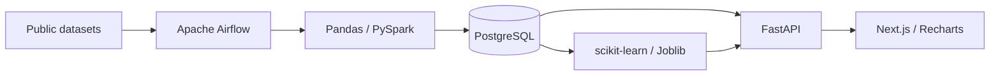

# EcoPulse AI

**Intelligent energy consumption monitoring, forecasting and anomaly detection.**

A local-first data and analytics platform built as a solo portfolio project. It
combines data engineering, machine learning, and full-stack development on a
fully inspectable local stack: no cloud hosting, no paid services, and no
invented production data.

> **Project status: Phase 5 - Serving: persistence, versioned API, real
> inference.**
> The monorepo, interface, API health contract, database wiring, containers, CI,
> raw dataset, inspection reports, EDA, the Phase 3 cleaning and transformation
> ETL, and the Phase 4 forecasting and anomaly experiments are in place. Phase 5
> adds PostgreSQL ingestion of the full 2,049,356-row Phase 3 dataset, three
> domain tables with Alembic migration `0002`, a modular FastAPI service that
> serves energy, forecast, anomaly, analytics and model endpoints from the real
> Phase 4 artefacts, and a 55-test suite run against a dedicated test database.
> Dashboards and cloud deployment are deliberately not implemented yet.

---

## What this is

EcoPulse AI is being built to answer three practical questions from real energy
data:

1. **What is consuming energy?** - interval-level monitoring with transparent
   data-quality treatment.
2. **What happens next?** - consumption forecasts evaluated with chronological
   splits and documented error metrics.
3. **What changed?** - anomaly detection that explains deviations in context.

The project is designed as a complete path from public dataset to local
analytics interface. Every layer is documented so the system can be understood,
run, and verified by another developer.

### What is intentionally absent

- No synthetic production data, sample dashboards, or placeholders that look
  like real measurements.
- No fabricated model metrics or anomaly labels. Phase 4 results are computed
  from the real Phase 3 Parquet outputs, and anomaly detections are explicitly
  unlabelled deviation candidates. API responses never invent a value: every
  number traces to a stored row or a loaded model.
- No cloud infrastructure, paid APIs, or live deployment.
- No authentication or multi-user tenancy; this is a local single-user project.
- No Airflow or Spark runtime in Phase 3. They are documented in the target
  architecture and will be added with the orchestration phase.

---

## Stack

| Layer | Technology | Role |
| --- | --- | --- |
| Interface | Next.js 16, React 19, TypeScript, Tailwind CSS 4, Recharts | Product surface and future analytics views |
| API | Python, FastAPI, Pydantic, SQLAlchemy 2, Alembic | Typed local service, persistence and versioned routes |
| Database | PostgreSQL 17, Alembic | Durable storage and versioned schema |
| Data engineering | Pandas, NumPy, PyArrow, Pandera, PySpark, Apache Airflow | Cleaning, validation, transformation and orchestration |
| Machine learning | scikit-learn, Joblib | Hourly forecasting and unsupervised anomaly detection (Phase 4), served by the API (Phase 5) |
| Testing | Pytest, Ruff, ESLint, TypeScript | Backend tests and frontend quality gates |
| Infrastructure | Docker, Docker Compose, GitHub Actions | Reproducible local runtime and CI |

Python environments are intentionally separated:

- `backend/` runs the API only. It carries the inference stack
  (`pandas`, `numpy`, `scikit-learn`, `joblib`, `pyarrow`) pinned to the Phase 4
  training versions so served predictions match the saved models, but it never
  imports `machine-learning/` or `data-engineering/` code.
- `data-engineering/` and `machine-learning/` carry the heavier analytics stack.
- Airflow will run in its own container, not in the API virtual environment.

---

## Architecture

The target data path is documented in [docs/architecture.md](docs/architecture.md).



Implemented in Phase 1:

- Next.js interface with a live infrastructure-status panel
- FastAPI service with liveness, readiness, and aggregate health endpoints
- SQLAlchemy session layer and an Alembic baseline migration
- PostgreSQL and application images wired through Docker Compose
- CI for backend lint/tests, frontend lint/types/build, and Compose validation

Phase 2 adds:

- UCI Individual Household Electric Power Consumption dataset pinned in `data/raw/`
- Dataset inspection script and five generated reports in `reports/eda/`
- Executed EDA notebook with ten saved figures (`reports/eda/figures/`)

Phase 3 adds:

- Cleaning and transformation modules with a narrow five-minute interpolation
  rule and explicit unresolved-gap accounting
- Four Parquet datasets in `data/processed/`: minute, hourly, daily and monthly
- Five reports in `reports/data-engineering/` and ten notebook figures
- Pandera schemas, cross-aggregate checks and Parquet readback validation
- An executed 20-section cleaning and transformation notebook

Phase 4 adds:

- Phase 3 Parquet inputs that are validated before any training or scoring
- A chronological 70/15/15 hourly forecasting experiment with five candidates,
  validation-only model selection, and a one-time test evaluation
- A leakage-safe 24-feature pipeline and a saved Random Forest bundle that
  reproduces its stored test predictions
- A train-only Isolation Forest plus a causal rolling z-score baseline, with no
  supervised accuracy claims
- Six reports and twelve figures in `reports/machine-learning/`
- Two executed notebooks covering forecasting and anomaly detection

Phase 5 adds:

- Batched, idempotent import of all 2,049,356 cleaned minute rows into
  PostgreSQL, with progress reporting and duplicate-safe inserts
- Alembic revision `0002`: `energy_readings`, `forecast_records`,
  `anomaly_records`, with `Numeric(18, 9)` precision for energy, predictions and
  scores
- A modular API (`endpoints → services → repositories → models`) serving health,
  energy, forecast, anomaly, analytics and model routes under `/api/v1`
- Real inference: the saved Phase 4 models are loaded once at startup and served
  with feature parity verified against the Phase 4 datasets
- Structured JSON logging with request IDs, a single JSON error envelope, and
  restricted CORS
- Swagger UI at `/docs`, ReDoc at `/redoc` and `/openapi.json`
- 55 Pytest tests against a dedicated `ecopulse_test` database, plus a live
  34-check endpoint verification against a running server

Still not implemented: automated dataset download, Airflow DAGs, Spark jobs,
consumption dashboards, authentication, and cloud deployment.

---

## Repository layout

```text
EcoPulse-AI/
├── .github/workflows/ci.yml    CI: backend, frontend, Compose validation
├── .env.example                Docker Compose environment
├── airflow/
│   └── dags/                   Airflow DAGs (later phases)
├── backend/
│   ├── alembic/                Migrations: 0001 baseline, 0002 domain tables
│   ├── app/
│   │   ├── api/v1/endpoints/   health, energy, forecasts, anomalies, analytics, models
│   │   ├── core/               Settings, typed errors, JSON logging
│   │   ├── db/                 SQLAlchemy engine, session, declarative base
│   │   ├── ml/                 Model registry and causal inference features
│   │   ├── models/             ORM models for the three domain tables
│   │   ├── repositories/       Query layer
│   │   ├── schemas/            Pydantic request/response contracts
│   │   ├── services/           Business logic
│   │   └── main.py             Lifespan, middleware, error handlers, docs
│   ├── scripts/                Batched Parquet importer
│   ├── tests/                  55 Pytest tests against ecopulse_test
│   ├── README.md               Backend setup, endpoints and verification
│   ├── Dockerfile
│   └── requirements*.txt
├── data/
│   ├── raw/                    Immutable downloads (ignored by Git)
│   ├── processed/              Derived datasets (ignored by Git)
│   └── external/               Third-party reference data (ignored by Git)
├── data-engineering/
│   ├── src/                    Inspection, cleaning, transformation and ETL modules
│   ├── notebooks/              Executed Phase 2-4 notebooks
│   └── requirements.txt
├── database/
│   ├── init/                   Future bootstrap SQL
│   └── seeds/                  Small documented reference data
├── docs/
│   ├── architecture.md
│   ├── design-system.md
│   └── development.md
├── frontend/
│   ├── app/                    App Router pages, layout, global styles
│   ├── components/             Product surface and live status components
│   ├── lib/                    Site configuration and health client
│   ├── Dockerfile
│   └── package.json
├── machine-learning/
│   ├── src/                    Phase 4 preparation, training and evaluation scripts
│   ├── utils/                  Shared features, metrics and validation
│   ├── models/                 Local Joblib artefacts; JSON metadata is committed
│   └── requirements.txt
├── reports/
│   ├── eda/                    Phase 2 inspection reports and figures
│   ├── data-engineering/       Phase 3 cleaning, validation and ETL reports
│   └── machine-learning/       Phase 4 metrics, reports and twelve figures
├── scripts/                    Reserved for repeatable operations
├── tests/                      Future cross-system tests
└── docker-compose.yml
```

---

## Quick start

### Prerequisites

- Windows 11
- Node.js 22+ and npm
- Python 3.11-3.13 (3.13 tested locally; containers use 3.12)
- Docker Desktop with the WSL 2 backend
- Git

Java 17 is only needed for future PySpark work; Airflow will run in Docker
because it does not support native Windows execution.

### Option A - full stack with Docker Compose

```powershell
cd D:\ai\EcoPulse-AI
Copy-Item .env.example .env
# Start Docker Desktop first, then:
docker compose up --build
```

| Service | URL |
| --- | --- |
| Web interface | http://localhost:3000 |
| FastAPI docs | http://localhost:8000/docs |
| ReDoc | http://localhost:8000/redoc |
| Aggregate health | http://localhost:8000/api/v1/health |
| PostgreSQL | localhost:`POSTGRES_PORT` (5433 in this local `.env`) |

Stop the stack with `docker compose down`. Add `-v` only when you intentionally
want to delete the local database volume.

### Option B - local development

Start PostgreSQL only:

```powershell
cd D:\ai\EcoPulse-AI
docker compose up -d db
```

Backend (terminal 1):

```powershell
cd D:\ai\EcoPulse-AI\backend
py -3.13 -m venv .venv
.\.venv\Scripts\Activate.ps1
python -m pip install -r requirements-dev.txt
Copy-Item .env.example .env
# Set DATABASE_URL to the host port published by the db container (5433 here).
alembic upgrade head
python scripts\import_processed_data.py          # 2,049,356 rows, idempotent
uvicorn app.main:app --reload --port 8000
```

Frontend (terminal 2):

```powershell
cd D:\ai\EcoPulse-AI\frontend
npm install
Copy-Item .env.example .env.local
npm run dev
```

Open http://localhost:3000. The status panel queries the real API health
endpoint; when PostgreSQL is unavailable it reports a degraded state instead of
inventing a successful one.

Full backend instructions, the endpoint reference and the verification record
are in [backend/README.md](backend/README.md).

### Option C - Phase 4 machine-learning pipeline

The four Phase 3 Parquet outputs must exist in `data/processed/`. Use the
dedicated ML environment; do not install these packages into the backend:

```powershell
cd D:\ai\EcoPulse-AI\machine-learning
py -3.13 -m venv .venv
.\.venv\Scripts\python.exe -m pip install -r requirements.txt

cd D:\ai\EcoPulse-AI
machine-learning\.venv\Scripts\python.exe machine-learning\src\06_run_ml_pipeline.py
```

The pipeline validates the Phase 3 inputs, prepares both leakage-safe datasets,
trains and evaluates five forecasting candidates, fits the unsupervised anomaly
detectors, reloads both saved models, and writes six reports plus twelve figures.
The verified local run completed in about 163 seconds with 128/128 checks passed.
See [machine-learning/README.md](machine-learning/README.md) for the data
contract, results and notebook commands.

---

## Environment variables

| Variable | Used by | Default / example | Purpose |
| --- | --- | --- | --- |
| `POSTGRES_DB` | Compose | `ecopulse` | Database name |
| `POSTGRES_USER` | Compose | `ecopulse` | Database role |
| `POSTGRES_PASSWORD` | Compose | `ecopulse_local_dev` | Local-only password |
| `POSTGRES_PORT` | Compose | `5432` (5433 in this local `.env`) | Host port for PostgreSQL |
| `API_PORT` | Compose | `8000` | Host port for FastAPI |
| `FRONTEND_PORT` | Compose | `3000` | Host port for Next.js |
| `DATABASE_URL` | Backend | `postgresql+psycopg://...@localhost:5433/ecopulse` | SQLAlchemy connection URL |
| `ML_MODELS_DIR` | Backend | `../machine-learning/models` (`/models` in Compose) | Where the Phase 4 artefacts are loaded from |
| `CORS_ORIGINS` | Backend | `http://localhost:3000,...` | Comma-separated browser origins |
| `ENVIRONMENT` | Backend | `development` | `development`, `test`, or `production` |
| `DEBUG` | Backend | `false` | Debug flag; 500 responses expose only an exception type |
| `LOG_LEVEL` | Backend | `INFO` | Structured JSON log level |
| `IMPORT_BATCH_SIZE` | Backend script | `5000` | Rows per import batch (max 6000) |
| `IMPORT_PROGRESS_EVERY` | Backend script | `10` | Batches between progress lines |
| `TEST_DATABASE_URL` | Backend tests | derived from `DATABASE_URL` | Optional explicit test database URL |
| `NEXT_PUBLIC_API_URL` | Frontend | `http://localhost:8000` | Browser-accessible API base URL |

Copy the provided `.env.example` files. Never commit `.env` files. Docker
Compose uses the root `.env`; native backend and frontend development use their
own local files. A native backend must point at the host port published by the
`db` container, which is `5433` in this checkout so it does not collide with
another local PostgreSQL.

---

## Quality checks

```powershell
# Backend (requires the db container: tests use a dedicated ecopulse_test database)
cd D:\ai\EcoPulse-AI\backend
.\.venv\Scripts\Activate.ps1
ruff check .
pytest

# Frontend
cd D:\ai\EcoPulse-AI\frontend
npm run lint
npm run typecheck
npm run build

# Compose configuration
cd D:\ai\EcoPulse-AI
docker compose --env-file .env.example config --quiet

# Phase 4 machine-learning pipeline and artefact verification
machine-learning\.venv\Scripts\python.exe machine-learning\src\06_run_ml_pipeline.py
```

The backend suite runs against `ecopulse_test`, never the development database.
Because `data/processed/` and the Joblib binaries are Git-ignored, a fresh clone
skips the tests that need them with an explicit reason instead of failing;
generate them with the Phase 3 and Phase 4 pipelines to run all 55 tests.
Verified locally: `ruff check .` clean, `55 passed`, and a live 34-check
endpoint verification against a running server.

GitHub Actions runs the same quality gates, including migrations against a real
PostgreSQL service. Container images are not yet built in CI; Compose syntax is
validated there and local builds are documented in
[docs/development.md](docs/development.md).

### API endpoints

All routes are versioned under `/api/v1`. Full request and response schemas are
in `/docs` and `/redoc`.

| Method | Path | Behaviour |
| --- | --- | --- |
| `GET` | `/` | Service metadata and documentation links |
| `GET` | `/docs`, `/redoc`, `/openapi.json` | Generated API documentation |
| `GET` | `/api/v1/health` | Aggregate health; always `200`, may be `degraded` |
| `GET` | `/api/v1/health/live` | API liveness; no database access |
| `GET` | `/api/v1/health/ready` | Readiness; `503` when a dependency is unavailable |
| `GET` | `/api/v1/energy` | Paginated minute readings with time filters |
| `GET` | `/api/v1/energy/summary` | Observation count, totals and extremes |
| `GET` | `/api/v1/energy/hourly` `/daily` `/monthly` | Aggregates with completeness flags |
| `POST` | `/api/v1/forecasts/predict` | Recursive 1/6/24/48-hour forecast, persisted |
| `GET` | `/api/v1/forecasts/history` | Stored forecasts with filters |
| `GET` | `/api/v1/forecasts/latest` | Most recent stored forecast point |
| `POST` | `/api/v1/anomalies/detect` | Score one stored or supplied minute, persisted |
| `GET` | `/api/v1/anomalies` | Stored detections with filters |
| `GET` | `/api/v1/anomalies/summary` | Counts and percentages per method |
| `GET` | `/api/v1/analytics/overview` | Energy, forecast and anomaly overview |
| `GET` | `/api/v1/analytics/consumption-patterns` | Hour-of-day, weekday and monthly profiles |
| `GET` | `/api/v1/models`, `/api/v1/models/{model_key}` | Loaded artefact metadata and thresholds |

Verified locally: **34 live checks passed** against a running server, covering
every route above plus the 404/422/503 error envelopes. Details are in
[backend/README.md](backend/README.md#10-live-endpoint-verification).

---

## Data principles

The project uses real public datasets only. Phase 2 selects the UCI household
dataset, records its source, licence and SHA-256 checksum, and profiles it before
any data is ingested. Phase 3 cleans and transforms it with documented rules:
only short gaps are interpolated, long gaps are not zero-filled, and unresolved
rows are excluded only from the final modelling dataset. Phase 4 reads those
Parquet files directly, validates them again, and preserves the same rules when
building features. Automated retrieval and the formal manifest are future work.

- Raw data stays immutable in `data/raw/`.
- Processed data is reproducible, never hand-edited.
- No chart is populated with invented values.
- Model quality is reported against a baseline with chronological evaluation.
- Unsupervised detections are labelled as candidates, never as confirmed faults.

See [data/README.md](data/README.md) and
[docs/architecture.md](docs/architecture.md#data-principles).

---

## Design direction

The interface uses a premium energy-intelligence identity: deep green-black
surfaces, restrained signal green, Geist typography, fine hairlines, and a
compact instrument-panel hierarchy.

### Palette

| Token | Hex | Usage |
| --- | --- | --- |
| Canvas | `#101713` | Page background |
| Surface | `#171F19` | Panels and cards |
| Surface raised | `#202A22` | Hover / secondary surfaces |
| Primary green | `#8BCF9B` | Signal, focus, primary actions |
| Accent green | `#B6E3B7` | Hover and emphasis |
| Primary text | `#F1F5F1` | Headings and body |
| Secondary text | `#9BA99D` | Supporting copy and metadata |

Full tokens and usage rules are in
[docs/design-system.md](docs/design-system.md).

---

## Documentation

- [Architecture](docs/architecture.md) - boundaries, runtime topology, decisions
- [Development](docs/development.md) - verified versions, setup, troubleshooting
- [Backend](backend/README.md) - setup, migrations, import, endpoints, verification
- [Design system](docs/design-system.md) - visual identity and chart guidance
- [Data engineering](data-engineering/README.md) - inspection, cleaning, ETL and notebooks
- [Machine learning](machine-learning/README.md) - Phase 4 forecasting, anomaly detection and verification
- [Data directory](data/README.md) - dataset rules and directory contract
- [Database](database/README.md) - schema ownership and migration workflow

---

## Known limitations

- Phases 1-5 are complete for the local backend: the full cleaned dataset is in
  PostgreSQL and forecasts, anomaly scores and analytics are served by the API.
  There are still no consumption dashboards, no Airflow/Spark orchestration, and
  no deployment. Raw data, processed Parquet files and model binaries remain
  local files that are not committed to Git.
- Forecasts are recursive beyond one hour. Only the one-hour horizon has a
  Phase 4 test metric (MAE 0.3194, RMSE 0.4626, R² 0.5726); longer horizons are
  produced by recursion and were not separately evaluated, and the experiment is
  one household with one chronological hold-out rather than a cross-household
  generalisation claim.
- The anomaly experiment has no reliable labels, so accuracy, precision, recall
  and F1 are not reported anywhere, including in API responses. Flagged minutes
  are statistical deviations for investigation, not confirmed faults, and the
  `severity` field is a triage heuristic rather than a calibrated fault rating.
- Anomaly scoring requires 24 prior observed hours; interpolated minutes are
  excluded from history, so timestamps near the start of the dataset return
  `insufficient_history`.
- Airflow is not running natively or in Compose yet; it is container-only on
  Windows and will arrive with the orchestration phase.
- The processed datasets exclude unresolved long gaps; aggregate totals for
  partial intervals therefore cover valid minutes only and are flagged.
- The Docker images have not been exercised automatically in CI.
- There is no authentication because the system is designed for local use only.
- The frontend status panel shows infrastructure state only. It is deliberately
  not a metrics dashboard.

## Roadmap

| Phase | Scope | Status |
| --- | --- | --- |
| 01 | Foundation: monorepo, UI shell, API, database wiring, containers, CI | Complete |
| 02 | Dataset collection, inspection, EDA, reports and findings | Complete |
| 03 | Cleaning, transformation, validation, ETL and Parquet outputs | Complete |
| 04 | Intelligence: hourly forecasting, anomaly detection and evaluation | Complete |
| 05 | Serving: PostgreSQL ingestion, versioned API, real inference, analytics | Complete |
| 06 | Experience: real-data dashboards and end-to-end interface tests | Not started |

Phases 1-5 are complete. Phase 6 is intentionally not started.
