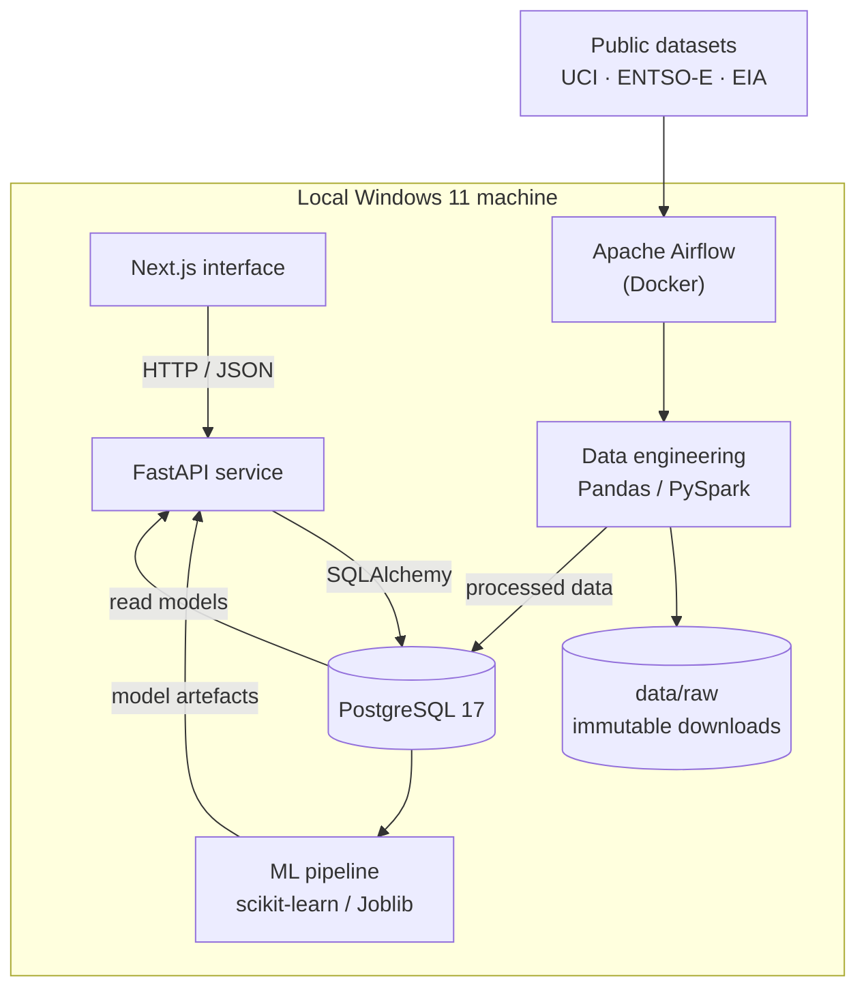
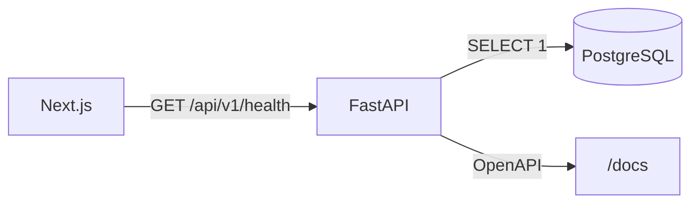
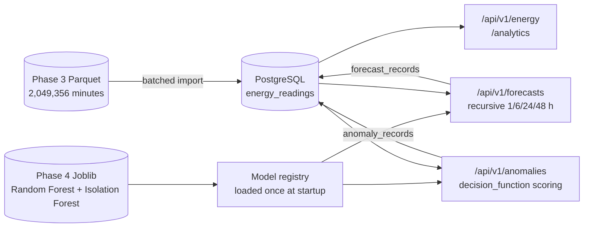
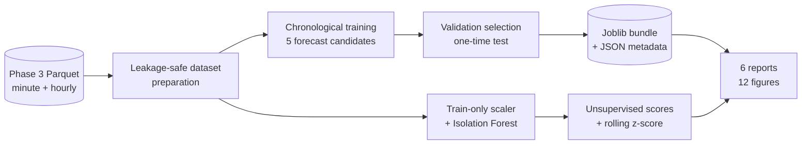

# Architecture

EcoPulse AI is a local-first energy intelligence system. This document describes
the boundaries that matter now, the target data path, and the decisions that
keep later phases maintainable.

**Document status:** Phases 1-5 implemented, later phases planned.

---

## 1. Goals and non-goals

### Goals

- Ingest real, public energy datasets into a documented local pipeline.
- Store processed observations in PostgreSQL with a versioned schema.
- Produce honest forecasts and anomaly explanations evaluated against
  baselines.
- Expose those results through a typed local API and a focused interface.
- Keep the whole system reproducible on Windows 11 with free software.

### Non-goals

- Cloud deployment, managed services, or paid APIs.
- Multi-tenant authentication and access control.
- Real-time smart-meter integration.
- Fabricated "demo" data or presentation metrics.
- Microservice decomposition. A modular monolith is appropriate for one
  developer and one machine.

---

## 2. System context



In Phase 1, the implemented subset is:



Phase 5 completes that path with domain data and real inference:



The Phase 4 machine-learning subset is a local batch path that reads Parquet
files directly instead of querying PostgreSQL:



---

## 3. Runtime topologies

### Docker Compose (integrated local stack)

| Service | Image / build | Responsibility | Port |
| --- | --- | --- | --- |
| `db` | `postgres:17-alpine` | Application database | `5432` |
| `backend` | `backend/Dockerfile` (Python 3.12) | FastAPI application | `8000` |
| `frontend` | `frontend/Dockerfile` (Node 22) | Next.js standalone server | `3000` |

The Compose network resolves services by name. The backend therefore connects to
`db:5432`. A backend running natively connects to `localhost:5432`.

The API and database remain independently observable through health checks. The
frontend waits for the API's liveness probe, while readiness reports database
availability separately.

### Native development

- Frontend: `next dev` on the host.
- Backend: Uvicorn with reload on the host, with PostgreSQL published on host
  port `5433` in this checkout so it does not collide with other local
  databases. `backend/.env` must use that port.
- Database: PostgreSQL container or a local PostgreSQL 17 installation.
- Machine learning: a dedicated `machine-learning/.venv`, run as a batch pipeline.
  The backend loads its saved artefacts but never imports that environment.
- Airflow/Spark: not started in any phase yet.

This mode is the fastest feedback loop and is documented in
[development.md](development.md). Backend-specific setup, endpoints and the
verification record are in [../backend/README.md](../backend/README.md).

---

## 4. Module boundaries

```text
frontend/            Presentation only. Talks to FastAPI via HTTP.
backend/             API, validation, persistence, and health reporting.
data-engineering/    Extraction, validation, and transformation modules.
machine-learning/    Features, training, evaluation, and serialised models.
airflow/dags/        Orchestration, importing data-engineering modules.
database/            Bootstrap/reference SQL and database documentation.
docs/                Architecture and operating notes.
data/                Local data lake directories, ignored by Git.
```

Rules:

1. The frontend never connects to PostgreSQL.
2. The API never imports data-engineering or machine-learning code at runtime.
3. Airflow imports pipeline modules; it does not contain business logic in DAGs.
4. Artefacts pass across boundaries through documented files or database
   tables, not implicit notebook state.
5. Each Python environment is isolated. The API image only installs backend
   requirements.

---

## 5. Backend design

### Application factory

`app/main.py` creates the FastAPI application, applies CORS, mounts the versioned
router at `/api/v1`, and exposes a small service root. The app name, version,
environment, database URL, and CORS origins come from
`app/core/config.py` (Pydantic Settings, read from the environment or
`backend/.env`).

During lifespan startup the application logs structured JSON, runs a database
health check, and loads both Phase 4 artefacts once into a process-wide,
thread-safe `ModelRegistry`. Model loading never crashes the process: a missing
or corrupt bundle is recorded in `registry.errors`, reported as `degraded` by
the health endpoint, and raised as `503 model_unavailable` when a route needs it.

### Package layout

| Path | Responsibility |
| --- | --- |
| `app/api/v1/endpoints/` | HTTP route definitions (health, energy, forecasts, anomalies, analytics, models) |
| `app/api/v1/router.py` | Versioned router assembly |
| `app/core/` | Configuration, typed API errors, JSON logging with request IDs |
| `app/db/` | Engine, sessions, and declarative base |
| `app/ml/` | Model registry and causal inference feature builders |
| `app/models/` | SQLAlchemy ORM models for the three domain tables |
| `app/repositories/` | SQLAlchemy query layer |
| `app/schemas/` | Pydantic request/response contracts |
| `app/services/` | Business logic and validation |
| `scripts/` | Batched, idempotent Parquet importer |
| `alembic/` | Migration environment and revisions `0001`, `0002` |

Request flow: `endpoint → service → repository → ORM model`. Endpoints stay
thin; services own validation and inference; repositories own SQL.

### Error contract

Every failure returns one envelope:

```json
{ "error": { "code": "validation_error", "message": "...", "details": null } }
```

Codes are `not_found` (404), `validation_error` and `insufficient_history`
(422), `database_unavailable` and `model_unavailable` (503), and
`internal_error` (500). Unexpected exceptions are logged with their traceback
but never returned to a client; `DEBUG` adds only the exception type.

### Health contract

| Endpoint | Database access | Success | Dependency failure |
| --- | --- | --- | --- |
| `/api/v1/health/live` | No | `200` | N/A |
| `/api/v1/health` | Yes (`SELECT 1`) | `200` with `status: ok` | `200` with `status: degraded` |
| `/api/v1/health/ready` | Yes (`SELECT 1`) | `200` with `status: ok` | `503` with `status: degraded` |

The aggregate endpoint intentionally does not raise an error when PostgreSQL is
down. The local product surface can then distinguish:

- API unreachable (fetch fails)
- API reachable, database unavailable (degraded)
- both healthy

Database errors are logged by exception type only; credentials and connection
strings never appear in responses.

### Failure behaviour

- The API process starts even if PostgreSQL is down, because the engine is lazy
  and no connection is opened at import time.
- `pool_pre_ping` avoids handing out stale connections after a database restart.
- Domain routes fail explicitly with the error envelope above; the health
  endpoint stays observational and always returns `200` except readiness.
- Missing model artefacts degrade the model checks instead of failing startup,
  so `/docs` and liveness remain available for debugging.

---

## 6. Database and migrations

- PostgreSQL 17 is the only supported database.
- SQLAlchemy 2.x uses the synchronous `psycopg` 3 driver.
- Alembic owns schema changes. No manual `CREATE TABLE` statements in the app.
- Revision `0001` is an intentional empty baseline so migration history was
  established before the domain schema existed.
- Revision `0002` introduces the Phase 5 domain tables.

| Table | Contents | Key constraints |
| --- | --- | --- |
| `energy_readings` | Imported Phase 3 minute observations | Unique naive `timestamp`, non-negative check constraints |
| `forecast_records` | One row per generated forecast point | `forecast_horizon` between 1 and 48 |
| `anomaly_records` | One row per scoring decision | `detection_method`, `severity`, `is_anomaly` |

Precision decisions:

- Energy, prediction and anomaly-score columns use `Numeric(18, 9)`. Minute
  energy values are recurring decimals (for example `0.070266666666667`), so a
  6-decimal column would drift in hourly sums; measured drift after the change
  is below `6.4e-9` per hour versus the Parquet source.
- Measurement timestamps are naive local civil time to match the immutable
  Phase 3 dataset; the API rejects timezone-aware inputs instead of inventing
  an offset. Audit columns (`created_at`, `detected_at`) are timezone-aware
  server times.

Why synchronous SQLAlchemy: the workload is local and analytical rather than
high-concurrency, and synchronous sessions are easier to reason about for a solo
developer. FastAPI still serves requests concurrently through its thread pool.

---

## 7. Data architecture (target)

### Pipeline

1. **Acquire** an open dataset from its documented source.
2. **Validate** schema, units, timestamps, duplicates, missing intervals, and
   ranges.
3. **Normalise** time zones to UTC, units to kWh, and keys to stable identifiers.
4. **Store** curated records in PostgreSQL through a reviewed schema.
5. **Engineer features** for forecasting and anomaly detection without future
   leakage.
6. **Train and evaluate** models with chronological splits and baseline
   comparisons.
7. **Serve** read models through FastAPI.
8. **Present** only values traceable to stored data.

Airflow will orchestrate steps 1-5. PySpark will be introduced when the data
volume or batch semantics justify it, not merely to satisfy a technology list.

### Data principles

- Raw files are immutable and stay in `data/raw/`.
- Every source has a manifest entry: URL, retrieval date, licence/attribution,
  checksum, and transformation notes.
- Processed files and database rows are reproducible from raw inputs and code.
- No synthetic production dataset is used to populate UI metrics.
- Timezone handling is explicit. Energy data frequently arrives in local time
  with daylight-saving transitions.
- Evaluation uses chronological splits; random splits are not acceptable for
  time-series forecasting.

### Phase 5 serving implementation

Phase 5 closes step 4 and step 7 of the pipeline for the backend.

- **Ingestion:** `backend/scripts/import_processed_data.py` streams
  `household_power_cleaned.parquet` row group by row group into
  `energy_readings` in batches of 5,000, validating schema, nulls, numeric
  ranges and timestamp naivety before any insert. Inserts use
  `ON CONFLICT (timestamp) DO NOTHING` and `RETURNING id`, so a re-run reports
  exactly how many rows were inserted rather than skipped. Verified full load:
  2,049,356 rows; verified re-run: `Inserted: 0`.
- **Serving:** every API number is either a stored row or a loaded model
  output. Forecast and anomaly writes land in `forecast_records` and
  `anomaly_records`, so history endpoints read persisted results rather than
  recomputing them.
- **Inference parity:** the Phase 4 feature engineering is reimplemented in
  `backend/app/ml/inference.py` and compared against the Phase 4 datasets on
  real rows (forecast features within `4.219e-15`, predictions within
  `3.331e-16`, anomaly scores within `6.801e-09`, zero label disagreements).
  The backend never imports `machine-learning/` code at runtime.
- **Aggregates:** hourly, daily and monthly endpoints group in SQL and mark
  incomplete periods instead of silently treating missing minutes as zero.

### Phase 4 machine-learning implementation

Phase 4 keeps the same principles but runs as a local batch process over the
Phase 3 Parquet outputs, with no database dependency of its own.

- **Inputs:** revalidated `household_power_cleaned.parquet` and
  `household_power_hourly.parquet`. Raw files and Phase 3 outputs are never
  modified.
- **Forecasting target:** `total_energy_consumption_kwh` for complete clock-hours
  only. Incomplete hours keep a missing target; they are never treated as zero.
- **Forecasting features:** 24 calendar, cyclical, lag and rolling features. Every
  lag and rolling statistic is shifted by one hour, and feature warm-up is
  excluded before splits are assigned.
- **Split policy:** chronological 70/15/15. Validation RMSE selects the model;
  the test split is predicted once after selection and never reused for tuning.
- **Candidates:** lag-1 persistence, 24-hour seasonal persistence, Linear
  Regression, Random Forest and HistGradientBoosting.
- **Saved artefact:** only the selected model, wrapped with its feature names and
  metadata. The Joblib binary stays local; JSON metadata and feature definitions
  are committed.
- **Anomaly inputs:** cleaned minute rows, excluding the 76 interpolated rows and
  rows without a complete prior 24-hour baseline.
- **Anomaly methods:** a causal rolling z-score baseline and an Isolation Forest
  fitted on the training split only, including a train-only scaler.
- **Honesty constraint:** no reliable anomaly labels exist, so accuracy,
  precision, recall and F1 are not reported. Detections are deviation candidates.
- **Outputs:** six reports, twelve figures, prepared datasets, predictions and
  training summaries under `data/processed/ml/`. Prepared outputs are ignored by
  Git and reproducible from the committed code.

### Dataset shortlist

| Source | Data | Access |
| --- | --- | --- |
| UCI ML Repository | Individual household electric power consumption, minute-level, 2006-2010 | Direct download |
| ENTSO-E Transparency Platform | European load, generation, and exchange data | Free account / API |
| U.S. EIA Open Data | Regional electricity demand and generation | Free API key |

The UCI household dataset was selected and inspected in Phase 2 and cleaned in
Phase 3. Automated retrieval and a formal source manifest are still future work.

---

## 8. Frontend design

- Next.js App Router with server components by default.
- Only the runtime-status panel is a client component, because it performs live
  health requests in the browser.
- `NEXT_PUBLIC_API_URL` is a build-time, browser-visible value. It must point to
  the API as seen from the host browser, not the Compose service name.
- The status panel polls every 30 seconds, aborts slow requests, and exposes a
  manual recheck.
- Recharts is installed for later analytics views and is not used to render fake
  placeholder series in Phase 1.

---

## 9. Environments and configuration

| Environment | Database host | Frontend origin |
| --- | --- | --- |
| Native development | `localhost` | `http://localhost:3000` |
| Docker Compose | `db` | `http://localhost:3000` |
| CI | `localhost` service container | Build only |

CORS is allow-listed through `CORS_ORIGINS`. Credentials are disabled because no
authentication exists. Local development passwords are not secrets; real
credentials must never be committed.

---

## 10. Security posture

EcoPulse AI is explicitly local-only:

- No authentication, so the API must not be exposed to untrusted networks.
- PostgreSQL is bound to the local host for development.
- No cloud storage or third-party processing receives application data.
- Secrets live in ignored `.env` files; examples use local dummy values.
- Health errors are sanitised before leaving the process.

If deployment ever becomes a goal, authentication, TLS, secret management,
rate limiting, and dependency scanning must be designed first.

---

## 11. Key decisions

| Decision | Rationale |
| --- | --- |
| Monorepo by concern | One developer can change API, UI, and pipeline atomically. |
| Modular monolith | Avoids distributed-system overhead with no scale requirement. |
| FastAPI + SQLAlchemy | Typed contracts and explicit persistence without a heavy framework. |
| PostgreSQL | Strong SQL, time-series-friendly indexing, and a realistic data-engineering target. |
| Separate Python environments | Prevents Airflow/Spark/ML dependencies from destabilising the API image. |
| Airflow only in Docker | Airflow cannot run natively on Windows; Docker keeps the host clean. |
| Empty initial Alembic baseline | Establishes migration history without inventing a premature schema. |
| Live infrastructure status instead of fake metrics | Demonstrates the stack honestly before data exists. |
| No authentication in Phase 1 | Local single-user project; avoid a false sense of security. |
| Chronological 70/15/15 splits with validation-only selection | Prevents temporal leakage and test-set reuse in both Phase 4 experiments. |
| One-hour forecast horizon from causal lags | Matches the available resolution; recursive multi-day forecasting was not validated. |
| Unsupervised anomaly detection without accuracy claims | No reliable labels exist, so detections are framed as investigation candidates. |
| Inference features reimplemented in the backend | The API never imports the training environments, yet stays numerically identical to Phase 4. |
| One process-wide model registry loaded at startup | Model files are read once, predictions are consistent within a process, and a missing bundle degrades to `503` instead of crashing. |
| `Numeric(18, 9)` for energy, predictions and scores | Minute energy values are recurring decimals; 6-decimal storage drifted hourly sums by more than `6.4e-9`. |
| Naive local timestamps for measurements | Matches the immutable Phase 3 dataset; timezone-aware inputs are rejected rather than silently converted. |
| Duplicate-safe batched import | `ON CONFLICT DO NOTHING` plus `RETURNING id` makes a 2-million-row import safe to re-run and honestly reportable. |
| Honest test skips for git-ignored artefacts | Fresh clones skip Parquet- and model-dependent tests with an explicit reason instead of failing or inventing data. |

---

## 12. Phase boundary

Phases 1-5 end at a runnable foundation, a reproducible local data pipeline, a
local intelligence layer, and a serving layer over real data:

- Phase 1: monorepo, API, database wiring, frontend shell, containers and CI.
- Phase 2: raw dataset inspection, EDA, reports and figures.
- Phase 3: deterministic cleaning, feature engineering, gap-aware aggregation,
  validation and four Parquet outputs.
- Phase 4: leakage-safe hourly forecasting, unsupervised anomaly detection,
  saved local models, six reports, twelve figures and two executed notebooks.
- Phase 5: full PostgreSQL ingestion (2,049,356 rows), domain schema under
  Alembic revision `0002`, a modular versioned API serving energy, forecast,
  anomaly, analytics and model routes with real Phase 4 inference, and a 55-test
  suite against a dedicated test database.

The project still deliberately does **not** include:

- Airflow DAGs or Spark jobs,
- consumption dashboards and end-to-end interface tests,
- automated dataset download and a formal source manifest,
- authentication or multi-user tenancy,
- cloud deployment.

Those are separate phases with their own review and verification.
